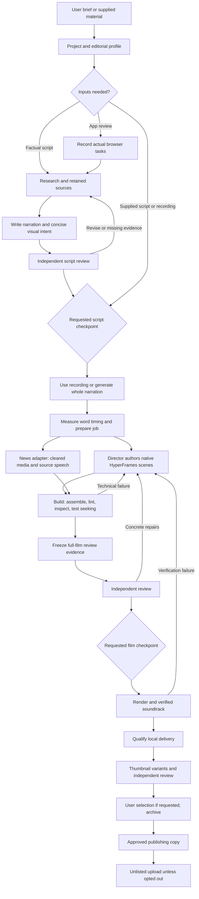

# Pipeline architecture

Creative work belongs to agents; reproducibility and evidence belong to the pipeline. The native picture
path uses a small manifest and freely authored HyperFrames scenes. No world/composite library is loaded
for that path. Browser capture has a specialised compiler; actual-media news has its own edit adapter.

`lib/project.mjs` tracks script/research/checkpoints and transport handoffs. `lib/film.mjs` derives film
state and coordinates build/review/render. `lib/briefs.mjs` serializes data-only assignments. `lib/personalities.mjs` retains the selected
`PROFILE.md` as project intent; catalog profiles have no separate JSON descriptor. `lib/native.mjs` assembles native compositions using the pinned
HyperFrames runtime and captures the actual player, including handwritten HTML scenes. `lib/review*.mjs`
binds evidence to sources and qualifies delivery. `lib/mix.mjs` and audio verification own the soundtrack.

The capture adapter uses `lib/capture-scene.mjs`, a native media-cut adapter. These are optional
executable tools, not default agent context. Load capture.md only for that work.
News uses `lib/news.mjs` and its own rights, speech and subtitle contracts.

Technical checks establish known properties, not creative quality. Sampled inspection does not prove the
absence of every defect. Full visual review and truthful reporting of unavailable playback/listening remain
necessary. The configured creative review budget can end with disclosed unresolved findings.
