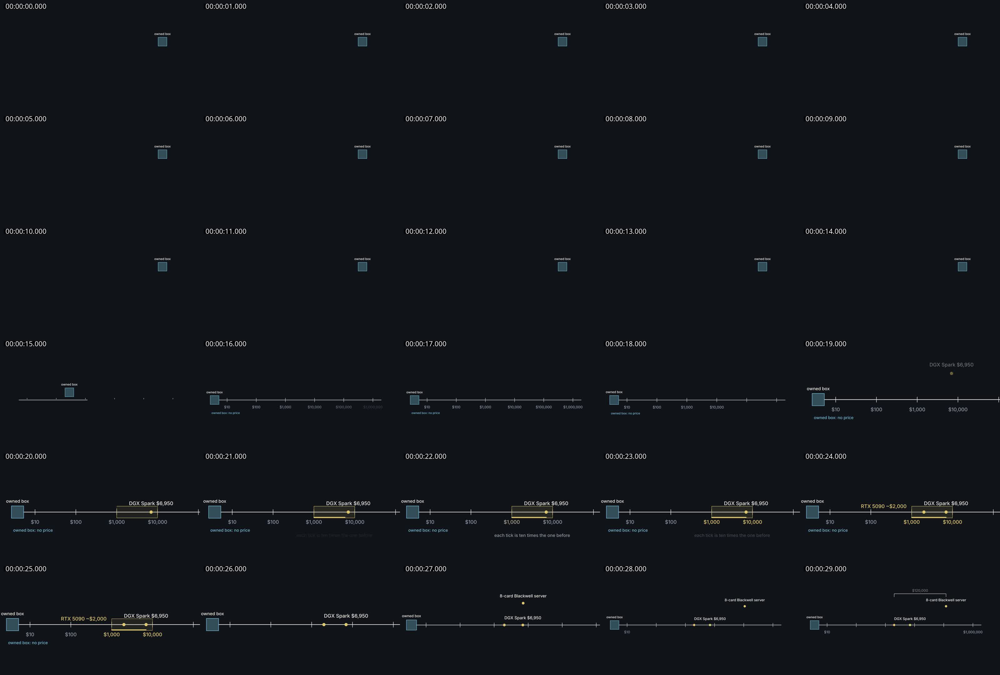
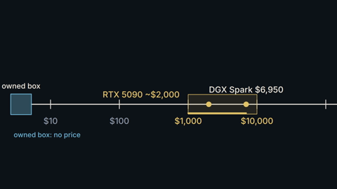

# Workflow audit — 15 October 2026

Follow-up: the authorized fixes are recorded in [CHANGES.md](CHANGES.md), with the original audit probes rerun in
[after-fixes.json](after-fixes.json). The findings below describe the audited pre-fix version and remain historical evidence.

The current rewrite is **not verified to produce better videos**. It adds useful orchestration and inspection machinery, but the supplied v2 job demonstrates a production scheduling failure, and isolated experiments reproduce false quality passes. Passing the test suite does not establish the claimed creative improvement.

## Scope and verification

- Reviewed the uncommitted rewrite against HEAD `d8226f4`, the workflow instructions, briefs, compiler, inspectors, review validator, and actual job records.
- Audited `jobs/can-9-year-old-gpu-beats-today-s-latest--2` (the job identified in the Claude handoff). Examined ordered encoded-frame samples across all 30 seconds and a 480 px sample; also compared contact sheets from two earlier outputs for context.
- Ran `npm test`: **42 passed, 0 failed**. The new scene-spec tests cover schema/cue compilation; the CLI delivery integration fixture still uses the legacy `beats.json` path. There is no end-to-end test of the new `next` production loop in this suite.
- Ran isolated probes against copies/synthetic fixtures, including a real headless Chrome inspection. See [probes.mjs](probes.mjs) and [results.json](results.json). Synthetic review records were only passed to validation in memory; they were not submitted as real reviews.
- Re-rendered a copy of v2 using `npm run video -- render`, then ran `next`. Render, media verification, and pixel checks passed; `next` advanced to **freeze prototype review evidence**.
- Did not change the original job, produce creative repairs, or submit reviews. This audit used sampled images and deterministic checks, not supported audio listening or normal-speed video playback. It does not resolve whether the recording says “Spark” or “Park.”

## Findings, in repair priority order

### P1 — Prototype scheduling omits the dependencies its own reviewers require

Location: `lib/film.mjs:218–227`, `lib/film.mjs:270–283`, `lib/briefs.mjs:117–141`.

Before prototype acceptance, `next` requests only the prototype scene. It does not build the earlier scenes that establish carried subjects. In this job, `ladder` carries `price-axis` and `you-marker`, but `motives` is never requested before the gate. The brief tells the builder these objects are defined earlier even though that scene has not been built.

The resulting draft has no `motives` scene from **0–14.70 s**. A small “owned box” is visible because the later scene defines it with `visible: true`; it is not a completed opening. The build reports `ok: true, missing: ["motives"]`. DOM and pixel inspections exclude missing scenes, so their success does not cover those 14.7 seconds.

The visual reviewer correctly blocks the missing motives-to-ladder handoff. The repair dispatcher maps the finding's 14.7–14.9 s timestamps to `ladder`; that builder is forbidden to edit `film.json` or `motives`. Meanwhile `motives` remains locked behind acceptance. This is a dependency/scope deadlock, not something another label adjustment can solve.

Independent reproduction using the preceding job's real `prices` prototype alone produces **7 undefined-target errors** for carried objects `own`, `rail`, and `chip`.

Repair: define object ownership and scene prerequisites explicitly. Build the required introduction/handoff context before reviewing a dependent prototype, or provide an explicit prototype setup that is reviewed as a setup. Route findings to the responsible scene or director, including findings whose cause precedes their timestamp. Distinguish “prototype scope passed” from “complete film passed.”

### P1 — Camera motion falsely satisfies the development requirement

Location: `lib/inspect.mjs:100–110`, `lib/inspect.mjs:121–134`.

The inspector measures development using screen-space object bounding boxes. A camera pan moves every box, so it counts every stationary object as developing, then counts the camera again.

Reproduction: three circles with no object animation, plus one 6-second camera pan. Actual Chrome inspection returned **no errors or warnings**, `windows: [4,4,4,4]`, and `longestStill: 0.25`. The only action in the transcript was `camera`.

This directly explains why adding camera motion can appease the automated gate without improving the explanation. The pixel checks can detect literal frozen frames, but cannot repair this semantic error: a pan changes pixels too.

Repair: measure changes in object/world coordinates separately from camera changes. Treat camera motion as framing evidence. Keep a distinct review of whether the subject actually develops; element counts cannot certify that.

### P1 — Visual review can pass without visual inspection; the “blind” pass reads source-derived actions

Location: `lib/film.mjs:165–185`, `lib/briefs.mjs:173–177`, `lib/review.mjs:133–158`, `lib/inspect.mjs:140–160`.

The new directions explicitly permit the visual and legibility roles to use the motion transcript and automated checks when they cannot view images. The template pre-fills `mode: frame-sequence`, full coverage, and a limitation claiming sampled-frame inspection.

Reproduction: `validateReview` accepts a visual `pass` whose limitation explicitly says **“No images or video viewed; read only the motion transcript.”** This probe exercises record validation, not an authenticated reviewer session or the entire delivery gate.

The motion transcript is an action log augmented with sampled DOM positions. It is useful debugging evidence, but does not establish image appearance, occlusion, contrast, attention, or whether a mechanism reads. Providing it during the visual first pass also exposes action names and author-selected object IDs before the reviewer records what the image communicates. This weakens the earlier media-first review contract.

Repair: make visual inspection capability explicit and required for visual/legibility approval; unavailable capability must yield `incomplete`. Require actual image evidence and observed coverage, leave inspection claims unset in templates, and withhold action logs/storyboards until the visual first pass is saved. The host still has to commission genuine independent agents; a schema cannot authenticate that work.

### P2 — Repairs cannot escalate a bad concept back to the director

Location: `lib/film.mjs:210–215`, `lib/film.mjs:258–283`, `lib/briefs.mjs:117–123`.

The director is dispatched for a missing or structurally invalid plan. Once a plan passes schema validation, creative review failures go to scene builders, who cannot change the plan. After four review rounds the workflow stops. There is no explicit route to revise the mechanism or its dependency contract when those are the cause.

In this job the plan itself chooses a log price axis, dots, labels, and camera movement. Its opening also proposes equating a stack of subscription payments with an unpriced owned box. Builders are then asked to obey that mechanism while reviewers reject missing causal meaning and continuity. More animation counts cannot resolve an incoherent comparison.

Repair: distinguish implementation defects, missing prerequisites, and concept defects. Give repeated mechanism/meaning failures a director revision brief, then invalidate only affected work. Evaluate whether the visual form serves this narration: an introductory list of prices does not automatically benefit from an invented physical process or a strict activity quota.

### P2 — Review bookkeeping invalidates production sources

Location: `lib/review.mjs:55–57`, `lib/film.mjs:258–263`.

`sourceFingerprint` excludes `status`, `completedAt`, and `delivery`, but includes `reviewRounds`. Dispatching a repair increments `reviewRounds` and therefore changes the source digest even if no visual, timing, or audio input changes. That invalidates the build/render/pack and can require a complete render merely to record a failed round.

Repair: keep review progress outside the render-input digest. Make reading the next step idempotent; count a round when a distinct reviewed artifact completes, not whenever the same failed state is queried. Continue invalidating reviews for actual production changes.

### P2 — A persisted complete flag bypasses current qualification in `next`

Location: `lib/film.mjs:202–205`.

Reproduction: a fixture containing only `job.json` with `status: complete`, and no MP4, delivery receipt, or reviews, gets `STATE: done` and “The film is delivered.” The `deliver` command has substantially stronger checks; this early return bypasses them on resume.

Repair: verify current delivery evidence and the delivered MP4 hash before reporting done. Test deletion or modification after a genuine delivery as well as a bare status fixture. This is a completion-reporting weakness; it is not evidence that this v2 job was delivered (it was not).

### P2 — Audio policy changed without updating its stated contract

Location: `lib/audio-verification.mjs:51–56`, `docs/independent-review.md:241–248`.

The code now fits a global gain; the documentation still explicitly says there is no gain correction. V2 has correlation **0.999786**, fitted normalized error **0.020674**, unfitted error **0.410965**, and fitted gain **0.708952**. The latter is consistent with the render being approximately 3 dB louder than the source.

The unfitted error alone is **not proof of corrupted narration**: a uniform level change explains a large amplitude error while preserving the waveform. The handoff overstates that concern. Conversely, fitted waveform similarity is not listening and cannot settle “Park” versus “Spark,” perceived intelligibility, or visual/audio timing by ear. The narration report correctly discloses that it did not listen.

Repair: choose and document the intended gain policy, test its boundaries and clipping cases, and preserve honest capability reporting. Use supported listening when a spoken-word ambiguity matters.

## What happened to the alleged build/render loop

The original latest MP4 hashes to `474003ce00b8270ce81a9de4f2bff8aa2ade4f2b351fa18304544961b47ad47e`. Its technical verification agrees, but `render-source.json` still names the older MP4 hash `e9f4601e94686ecceb96a96939c1441870fae0007f060cad5318c90a1a9f7b99` and an older source hash. Requesting another render is therefore expected.

Three build/next probes on a copy produced stable source hashes and consistently requested rendering; `plan-check` did not keep changing production files. A full clean render then produced matching receipts and advanced to review preparation. It generated the **same MP4 SHA-256** as the latest original, with zero pixel-check errors and `motives` still missing.

Thus the reported endless loop was **not reproduced** in a clean run. An interrupted/failed prior render is a possible explanation for the receipt mismatch, not an established cause. Stale-review rejection after actual repairs is correct behavior and should remain.

## Output quality and acceptance criteria

The encoded samples support the user's criticism of this particular draft: almost half the runtime lacks its intended scene, the remainder is dominated by a thin axis and labels, and the 480 px sample retains `RTX 5090 ~$2,000` despite narration timing records saying “over 2 grand.” Existing review history already identified the delayed 5090 appearance and qualifier mismatch; the latest stored narration pass marks these advisory. It is not a current acceptance of the latest file.

Useful work in the rewrite includes self-contained briefs, cue-based compilation, browser inspection, and retained review history. Those are implementation capabilities, not demonstrated gains in finished quality. The earlier workflow already had frozen evidence, source/render hashes, and independent delivery qualification; those protections should not be credited as new here.

Before calling the rewrite better:

1. Add regression tests for dependency-aware prototype scheduling, repair ownership/escalation, camera-only activity, unavailable visual review, bookkeeping stability, and resuming altered deliveries. Exercise the new film/next path rather than only legacy delivery fixtures.
2. Run one real first-30-second job through prototype, remaining scenes, final independent review, and delivery without operator workarounds. Every required scene must exist; all reviewed hashes must match the exact delivered MP4.
3. Compare completed old/new films using the same narration, excerpt, model/tool capabilities, and budget, with fresh reviewers blinded to workflow identity. Assess comprehension, timing, legibility, and coherent visual development; record failures, repair rounds, and cost as well as ratings.

That controlled comparison has not been performed in this audit. The evidence establishes concrete failures and lack of demonstrated improvement, not a universal claim that every new-workflow film will be worse.
