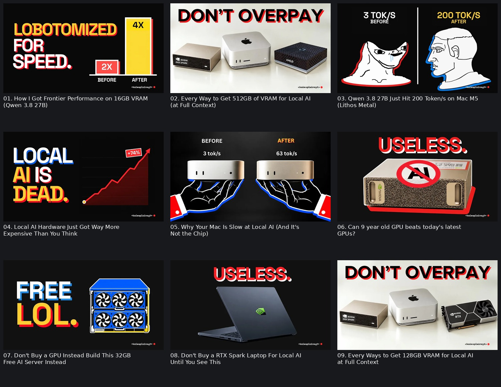
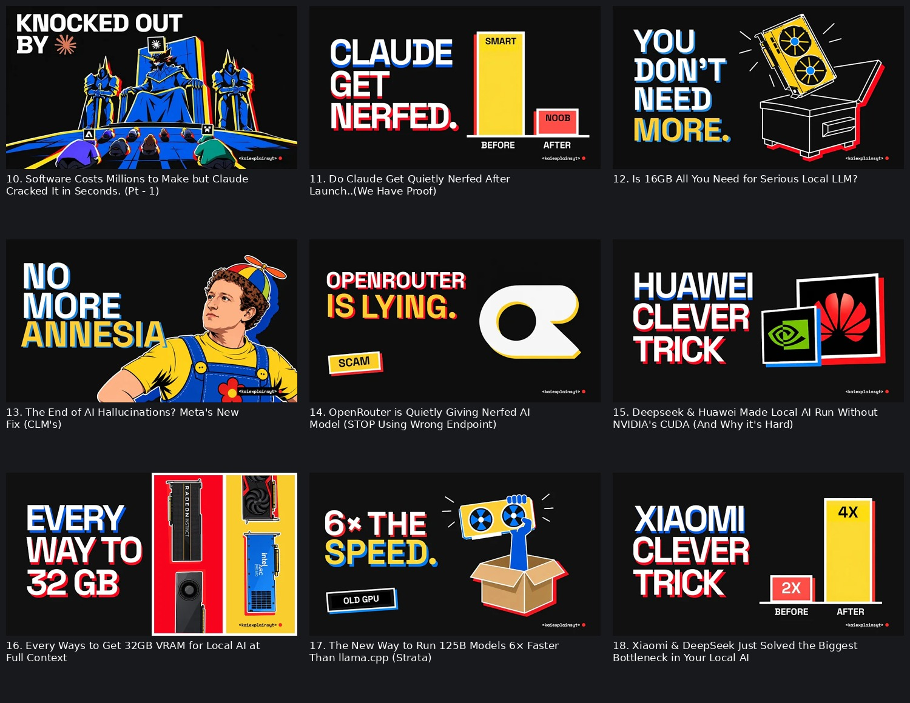

# Kai thumbnail and title reference

Captured and visually inspected on 19 October 2026. Creator-selected reference: [Kai's videos tab](https://www.youtube.com/@kaiexplainsYT/videos), channel ID `UCgUfJoPtkt7-RiiuYh4vmGA`.

The sample is the first 18 entries returned from the channel's videos tab. Titles and served thumbnails were captured together. These are current snapshots, not a record of thumbnails at publication or historical A/B variants. This study describes the images and their relationship to the titles. It does not verify the videos' technical claims or establish which design choices caused performance.

## Visual evidence

The numbered sheets show the actual downloaded thumbnails with their corresponding titles underneath. The added captions are reference labels, not part of the thumbnail.

[Source manifest](research/kaiexplains-2026-10-19/manifest.json) records every video URL, exact title, served thumbnail URL, local image filename, dimensions and SHA-256. The [raw channel response](research/kaiexplains-2026-10-19/channel-source.json) preserves the listing used to select the sample. Each source image is saved beside the manifest. Images are research references, not cleared production assets.

## What the thumbnails look like

### Background and color

Sixteen sampled images have a black or near-black background. The two exceptions, numbers 2 and 9, put a hardware buying comparison on a pale background. The dark designs use white text, saturated yellow emphasis, and red or blue accents. Red often marks a negative claim or the weaker condition; yellow often marks the emphasized word, result, or stronger bar. This is an observed tendency, not a consistent semantic code across every image.

### Typography

The headline is large, uppercase, heavy sans serif text. Most headlines use a few words with deliberate line breaks. Several letters have a hard red or blue offset shadow that reads like a second printed layer. White outlines and stacked color offsets recur in both text and drawings. On pale backgrounds, the headline can be black with a red offset. The exact font cannot be identified reliably from these rasters.

The images often use one large headline and much smaller supporting labels, such as BEFORE, AFTER or OLD GPU. Avoid treating those small labels as the essential message when adapting the approach for a phone screen.

### Composition

A frequent arrangement is headline on the left and the main image or comparison on the right. Another is a full-width headline at the top with a large product below. The before/after designs can dispense with a prose headline and devote the frame to two contrasted states. Background detail is sparse, and subjects have strong silhouettes. The small channel signature sits near the lower-right corner; branding does not dominate the frame.

### Image treatment

The sample combines product cutouts, flat vector-like illustrations, comic-style figures, meme faces, logos, simple charts, and drawn props. Red/blue/yellow outlines and shadows help these different asset types share a visual identity. Examples include a GPU coming out of a box, a laptop under a negative verdict, Mac computers on illustrated hands, and a throne scene for Claude. A recurring host portrait is not the organizing feature of this sample.

The image generally makes a comparison, object or consequence recognizable without reproducing an entire software interface. Most of the technical explanation remains in the video.

## How each thumbnail relates to its title

Titles below retain the channel's wording. Thumbnail transcriptions omit insignificant line breaks and final punctuation where appropriate.

| # | Video title | Thumbnail content | Relationship |
|---|---|---|---|
| 1 | [How I Got Frontier Performance on 16GB VRAM (Qwen 3.8 27B)](https://www.youtube.com/watch?v=h_KqS4GtU3I) | LOBOTOMIZED FOR SPEED, with a 2X/4X before/after bar comparison | The title promises performance under a hardware constraint. The image introduces a possible tradeoff or provocation that the video needs to explain. |
| 2 | [Every Way to Get 512GB of VRAM for Local AI (at Full Context)](https://www.youtube.com/watch?v=6tihP50zlcE) | DON'T OVERPAY, above three different compact computers on a pale background | The title defines the capacity and scope. The image turns the guide into a buying decision with a money-saving motive. |
| 3 | [Qwen 3.8 27B Just Hit 200 Token/s on Mac M5 (Lithos Metal)](https://www.youtube.com/watch?v=L7noXCBSObc) | Contrasted meme faces, 3 TOK/S BEFORE versus 200 TOK/S AFTER | The image repeats the headline result and adds a visually obvious starting state. The title supplies the model, chip and method. |
| 4 | [Local AI Hardware Just Got Way More Expensive Than You Think](https://www.youtube.com/watch?v=Y226-wwfCSw) | LOCAL AI IS DEAD, beside a red rising price line marked +74% | The title states a cost increase. The image escalates it into an editorial verdict and a numerical reason. The broader verdict requires separate scrutiny. |
| 5 | [Why Your Mac Is Slow at Local AI (And It's Not the Chip)](https://www.youtube.com/watch?v=x_qmqqp6d7s) | Similar Macs on drawn hands, BEFORE 3 tok/s versus AFTER 63 tok/s | The title poses a diagnostic question. Similar hardware with different results suggests that a change other than replacing the computer may matter. |
| 6 | [Can 9 year old GPU beats today's latest GPUs?](https://www.youtube.com/watch?v=eckOsa0kBkY) | USELESS above a modern Nvidia box, with a red prohibition symbol over AI | The title asks about an old-versus-new reversal. The image puts the negative verdict on the modern product and creates tension around that comparison. |
| 7 | [Don't Buy a GPU Instead Build This 32GB Free AI Server Instead](https://www.youtube.com/watch?v=IMVjEsKX5UQ) | FREE LOL, beside an illustrated blue multi-GPU server | The title specifies the proposed action and memory target. The image foregrounds the economic hook and object. What is actually free needs evidence. |
| 8 | [Don't Buy a RTX Spark Laptop For Local AI Until You See This](https://www.youtube.com/watch?v=aQKGejbv-Rs) | USELESS above a large Nvidia-branded laptop | The title identifies the purchase and creates a warning. The image supplies the compressed verdict without another technical explanation. |
| 9 | [Every Ways to Get 128GB VRAM for Local AI at Full Context](https://www.youtube.com/watch?v=NA9D49kQFuU) | DON'T OVERPAY above a compact Nvidia box, Mac and desktop GPU | Reuses the buying-guide treatment from number 2 at a different memory target. The title differentiates the guide; the image repeats the consumer motive. |
| 10 | [Software Costs Millions to Make but Claude Cracked It in Seconds. (Pt - 1)](https://www.youtube.com/watch?v=hl6VOfzky5E) | KNOCKED OUT BY with Claude's logo and a blue/yellow illustrated throne scene | The title supplies the incident and time/cost contrast. The image expresses disruption through a stylized scene rather than technical detail. |
| 11 | [Do Claude Get Quietly Nerfed After Launch..(We Have Proof)](https://www.youtube.com/watch?v=SxLUx8-hN1o) | CLAUDE GET NERFED, beside a tall SMART before bar and short NOOB after bar | The title presents an allegation with a proof promise. The image asserts the result and makes decline immediately visible. The bars are rhetorical unless supported by a defined measurement. |
| 12 | [Is 16GB All You Need for Serious Local LLM?](https://www.youtube.com/watch?v=i9mRnbdDYxk) | YOU DON'T NEED MORE, beside a yellow GPU over an open outlined box | The title asks a sufficiency question and gives the exact capacity. The image offers a short answer and emphasizes avoiding another purchase. |
| 13 | [The End of AI Hallucinations? Meta's New Fix (CLM's)](https://www.youtube.com/watch?v=9-iiHFQyzuM) | NO MORE AMNESIA with a cartoon treatment of Mark Zuckerberg | The title identifies the company and technical topic. The image substitutes a familiar human metaphor. Memory failure and hallucination are different concepts, so copying this substitution could create a misleading promise. |
| 14 | [OpenRouter is Quietly Giving Nerfed AI Model (STOP Using Wrong Endpoint)](https://www.youtube.com/watch?v=ZsnFX5mEJ4s) | OPENROUTER IS LYING, its large logo, and a SCAM label | The title describes an alleged endpoint/model problem. The image raises the accusation to intent and deception. Visual force does not establish that stronger claim. |
| 15 | [Deepseek & Huawei Made Local AI Run Without NVIDIA's CUDA (And Why it's Hard)](https://www.youtube.com/watch?v=uJcPjrEgppk) | HUAWEI CLEVER TRICK, with Huawei and Nvidia logos in offset frames | The title provides the technical relationship and caveat. The image turns it into a simple intrigue-driven explanation and recognizable company comparison. |
| 16 | [Every Ways to Get 32GB VRAM for Local AI at Full Context](https://www.youtube.com/watch?v=uavLRbbfM94) | EVERY WAY TO 32 GB, beside four GPU cutouts on red/yellow panels | The image largely repeats the title's coverage promise. The visible options make the guide's breadth tangible. This is reinforcement rather than complementary wording. |
| 17 | [The New Way to Run 125B Models 6× Faster Than llama.cpp (Strata)](https://www.youtube.com/watch?v=m0VHx73SAG0) | 6× THE SPEED, OLD GPU, and a hand lifting a yellow GPU from a box | The title supplies model scale, baseline and method. The image distills the result and suggests a benefit on existing hardware. |
| 18 | [Xiaomi & DeepSeek Just Solved the Biggest Bottleneck in Your Local AI](https://www.youtube.com/watch?v=RlRC_6hbBHc) | XIAOMI CLEVER TRICK, beside 2X/4X before/after bars | The title promises a bottleneck explanation. The image adds an intrigue phrase and a simplified improvement graphic. The meaning of the multipliers needs to be established in the video. |

## Patterns worth adapting

The title and thumbnail usually divide the information. A title names a model, device, capacity, method or baseline. The thumbnail supplies a short judgment, avoided cost, transformation or result that can be recognized before reading the full title. The title/image pair should still make sense together when either one is shortened in the feed.

Several repeated treatments could become editable concept templates:

| Treatment | Typical image | Role of the title | Requirement for our version |
|---|---|---|---|
| Buying guidance | A small set of recognizable products beneath a short caution | Identify the target workload and comparison | Explain the actual decision and conditions; do not label a product universally useless |
| Before/after | Two comparable states or a simple chart | Name the intervention and technical setting | Source the numbers, units, baseline and workload; use honest scales |
| Outcome | One clear object with a large result or avoided constraint | Supply how the outcome is achieved | Show the promised result and its limitations in the film |
| Mechanism or trick | Recognizable company/product symbols beside a short intrigue phrase | Name the technical relationship being explained | Reveal a real mechanism and support any claimed improvement |

Build the text, bars, labels, outlines and shadows as editable layers. Match the contrast, hierarchy and simplicity using our own assets and identity. Preserve only one central claim per concept. Use the reference images to judge composition and title relationship, not as stock artwork to reuse.

For an initial thumbnail brief, write the exact title, short image headline, subject, layout, background, accent colors, image/title relationship and payoff location in the video. Include source references for every numerical or factual visual claim. Inspect the pair at small feed size and ask a viewer what they expect to learn.

## What the sample cannot tell us

We did not obtain impression counts, CTR, watch time, variant history or randomized comparisons. Therefore these notes explain the creator-selected style, not a demonstrated growth formula. The technical and numerical claims shown here were transcribed for design analysis and were not fact-checked. The channel can change titles or thumbnails after this snapshot; retain the manifest and source images when using the reference in later experiments.
