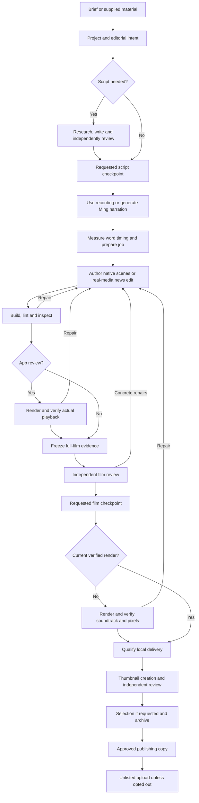

# Production transport

Agents make editorial and implementation decisions. The CLI tracks artifacts, evidence, requested
checkpoints and delivery. Use `npm run video -- help` for commands, loading specialised docs as needed.
Only start production when requested; brainstorming does not start a job.

## Project and handoffs

Save the agreed brief in `jobs/scripts/<slug>/BRIEF.md`, then create the project:

```bash
npm run video -- project-new --name <slug> --profile <id> --format landscape --tts ming
npm run video -- next --project <slug>
```

Optional flags include duration, supplied script/audio, review checkpoints and thumbnail count.
Use the selected profile from `personalities/README.md`. A resume uses the saved profile and artifacts.
Script outputs and evidence live in `jobs/scripts/<slug>/`; prepared video files live in `jobs/<slug>/`.
`next --project` covers preparation and then the film. `next --job` is for an already prepared job.
Use explicit names; do not restart an existing job or truncate a recording without a requested excerpt.

`next` derives the next task from files. Run command steps. For task data, write a focused assignment using the supplied artifact paths, scope and findings; independent review uses agents that did not produce the work. The host can reason about
failures and inspect artifacts; it is not forbidden from reading the work. The host may perform production work itself where appropriate; commission independent reviewers for review. Close tracked chat delegations
with `delegated --project <slug>` after they finish. Agents assigned tasks do not advance the host loop.

Research retains evidence; the writer produces narration and concise visual intent. The director chooses
and authors the actual picture. `VISUALS.md` is free-form intent, not a scene schema or binding design recipe.
A supplied script can go directly to direction. `docs/composition.md` defines the native HTML interface.
Use `docs/audio.md` only when narration is needed. Generate one complete narration invocation, keeping Ming's
shared reference through the continuity adapter. Supplied recordings remain unchanged.

## Review and completion

Build and inspect the real composition. `review-pack` freezes evidence of the full film before final render.
Use `docs/review.md` for report schemas. Review findings describe demonstrated defects and viewer
impact; aesthetic preferences are advisory. Missing evidence or failed technical checks is not a creative pass.
The configured review budget may end with disclosed findings; never call that an independently passed film.

At requested human checkpoints, show the actual artifact and record the person's decision faithfully.
Use the printed review/selection command with the user's verbatim quote. Requested Discord notifications use `scripts/discord-notify.mjs` and a stable request ID.
Do not turn a notification or elapsed time into approval.

After review and requested film approval, follow `next` through render and delivery. Report the qualified
MP4 and limitations from `review/delivery.json`. Describe audio measurements as measurements; claim listening
only when performed. A successful agent reply or draft render alone is not delivery.

Run `thumbnails --job <job>` through generation, independent review and selection. Dimensions match the
video. `docs/publishing.md` covers packaging and the format contract. If the person requested
selection, show variants and preserve their choice. Obtain approved title/description for publishing.
After selection, upload the qualified MP4 to abdupdates as unlisted unless the user opted out;
`docs/publishing.md` owns authentication and upload commands. Report the actual link or precise failure.

## Useful references

- Script outputs: `skills/script-writing/SKILL.md`.
- Native authoring: `docs/composition.md`.
- News edits/source speech: `docs/news.md`.
- Browser recording and cut evidence: `docs/capture.md`.
- Ming narration and soundtrack: `docs/audio.md`.


There is one canonical `skills/` folder. Configure harness skill discovery to use it; no per-harness
skill copies or catalogs are required. Harness role files are transport/model adapters, not another
source of creative instructions.

## Assignment data

The CLI returns inline assignment data: role, project/job, input paths, expected outputs, relevant technical
reference and findings. The host writes the assignment itself. Include the saved profile, canvas and measured timing, expected outputs, relevant findings, and the role boundary from AGENTS.md. Give independent reviewers their review role, frozen pack path and hash, and prior-decision history. The assigned agent reads the artifacts it needs and chooses its approach. There is no
separate prompt-file catalog or embedded creative instruction package.

| Assignment | Output / reference |
|---|---|
| Research | sources/ and SOURCES.md; script-writing sourcing reference |
| Script writing/revision | SCRIPT.md, research.md and concise VISUALS.md; script-writing skill |
| Script review | review.md with disposition; script-writing review reference |
| Direction | film.json and native scene files; composition.md |
| Scene build/repair | assigned native HTML and assets; composition.md |
| Film review | actual evidence inspection and submitted report; review.md |
| Thumbnail maker/reviewer | images, packaging copy, verdict/ranking; publishing.md |

Assignments with ownsPlan can revise film.json; scene authors coordinate shared changes. Role agents do
not advance host-only lifecycle commands. Use the harness's available delegation tool and live capability
catalog for tracked tasks. After a tracked batch finishes, run `delegated --project <slug>`.

`watch --project <slug>` serves read-only review artifacts and prints the actual URL. Share that address
(or its configured remote route) in the harness chat and record the person's reply faithfully.
`stage-bar --project <slug>` is an optional progress view. There is no application UI or separate runner.

## Pipeline



Idea discovery belongs to the host agent: research current sources, retain links and evidence, and record selected or rejected ideas in a project-local ledger when needed. There is no built-in feed collector or ranking command. Existing `.video/ideas/` records remain historical data.
