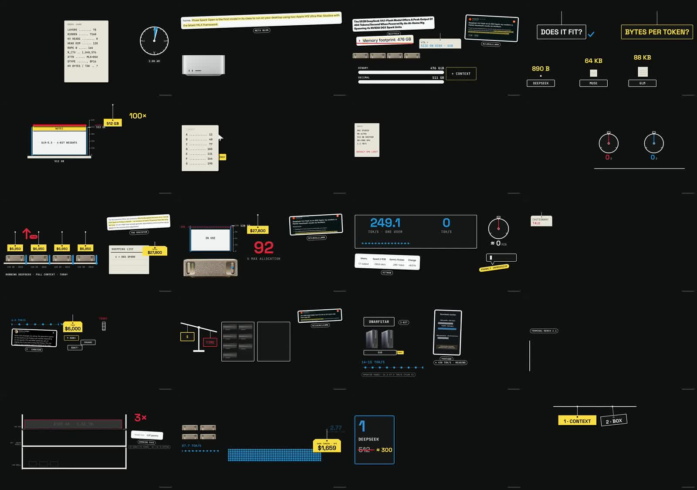
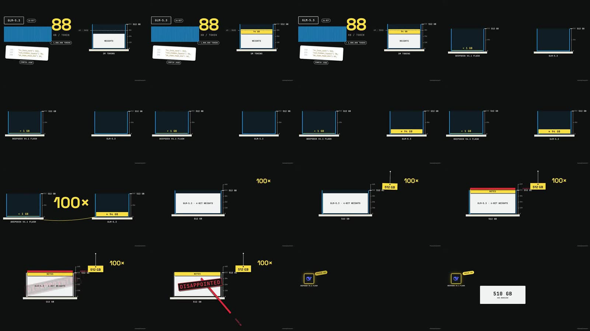

# Kai video frames: what fills a frame

Measured on 20 October 2026, so we know what "filled like Kai" means in numbers before changing the pipeline. Companion
to [the thumbnail study](kaiexplains-thumbnail-study.md). This is research for people improving the pipeline; agents
making a film never receive Kai's footage or these images (only the principles below, written into
[quality.md](../quality.md)).

Sample: four uploads from [Kai's channel](https://www.youtube.com/@kaiexplainsYT/videos), 17–22 minutes each, read at
480p: [512 GB of VRAM](https://www.youtube.com/watch?v=6tihP50zlcE), [200 tok/s on Mac M5](https://www.youtube.com/watch?v=L7noXCBSObc),
[Claude nerfed?](https://www.youtube.com/watch?v=SxLUx8-hN1o) and [DeepSeek & Huawei without CUDA](https://www.youtube.com/watch?v=uJcPjrEgppk).
The videos themselves are not kept in the repository; the contact sheets are research references, not assets.

## The numbers

`npm run video -- frame-stats --video <file.mp4>` measures any film the same way (one frame every 2 s):

| Film | Ink (typical frame) | Spread (typical frame) | Near-blank frames |
|---|---|---|---|
| Kai, 4 videos | 3–8% | 56–72% | 8–19% |
| Ours: tech-news roundup (5.6 min) | 7% | 33% | 14% |
| Ours: solar system / sky is blue | 5–7% | 41–62% | 0% |
| Ours: ocean waves (a full-width water fill) | 44% | 72% | 0% |

- **Ink**: share of pixels that differ from the background.
- **Spread**: the box spanned by rows and columns that hold content (specks ignored).
- **Near-blank**: frames with under 1.5% ink.

Raw output: [metrics.txt](../research/kaiexplains-frames-2026-10-20/metrics.txt).

**Kai does not put more on screen than we do.** His frames are mostly near-black. The thumbnails are packed, the video
frames are not. What differs is where the content sits and what it is: his content reaches across most of the frame,
ours clusters in a third of it.

## What his frames are made of

Other sheets: [Mac M5](../research/kaiexplains-frames-2026-10-20/sheet-L7noXCBSObc.jpg),
[Claude nerfed](../research/kaiexplains-frames-2026-10-20/sheet-SxLUx8-hN1o.jpg),
[Huawei](../research/kaiexplains-frames-2026-10-20/sheet-uJcPjrEgppk.jpg),
[Huawei, 32 s sequence](../research/kaiexplains-frames-2026-10-20/sequence-uJcPjrEgppk-120s.jpg),
[three Kai frames beside one of ours](../research/kaiexplains-frames-2026-10-20/compare-kai-vs-ours.jpg) (bottom right).

1. **The whole frame is used, asymmetrically.** The main object sits on one side, a huge number in the opposite
   corner, a source card in another. Ours tends to be one object near the centre.
2. **One hero per beat, everything else small.** Each beat has one very large yellow or red number or word (88,
   100×, 1,350, $27,800, 1/3) over a small uppercase mono unit. Labels are small and quiet. Ours is mostly
   medium-sized everything.
3. **Real evidence on screen.** Retyped tweets, Reddit posts, articles, `config.json` excerpts and benchmark tables sit
   on white or cream cards, with the key phrase highlighted in yellow and a small rounded chip under the card naming
   the source (r/LocalLLaMA, GITHUB, META BLOG). Ours shows icons standing in for the claim.
4. **A small, recurring vocabulary.** The same few objects appear in every video: yellow tags hanging from a pin on a
   line, red rubber stamps ("DISAPPOINTED"), memory as a container on a shelf with a scale beside it, cream spec sheets
   with key–value rows, rounded mono chips, timelines with a date marker. It never looks improvised.
5. **One stage builds for 20–40 s.** The container stays and fills; tags drop onto it; a stamp lands; the camera pans
   to what is new. Cuts are rare inside an idea.
6. **Photos are rare.** A few product renders appear (a Mac Studio, a DGX Spark); almost everything is drawn or
   typeset.

Empty frames are not the problem: Kai has 8–19% near-blank frames (transitions, a single chip). Our tech-news film's
weak frames were half-faded leftovers, empty placeholder boxes and small, centred clusters.

## What we changed because of it

- The kit gained the vocabulary as built-in objects: `card`, `tag`, `verdict`, `hero`, `gauge`, `sheet`, `chip`
  ([SCENE_SPEC.md](../SCENE_SPEC.md#composite-objects)).
- The composition guidance says "use the whole frame, one hero per beat" instead of "generous empty space"
  ([quality.md](../quality.md)).
- The build warns about narrow spread (under 40%), scenes without a hero, empty boxes and half-faded frames.
- The script writer plans each scene's layout, hero and evidence in `VISUALS.md`.
- A channel theme ([channel/theme.json](../../channel/theme.json)) gives every film the same recognisable look by
  default. Real things are drawn as SVG; the channel uses no photos.

## Limits

Four videos at 480p from one channel, sampled every 2 s. The measure counts luminance difference from the median
pixel, so coloured fills on a dark ground count as ink and very low-contrast elements do not. It describes the look;
it says nothing about which choices drive views.
